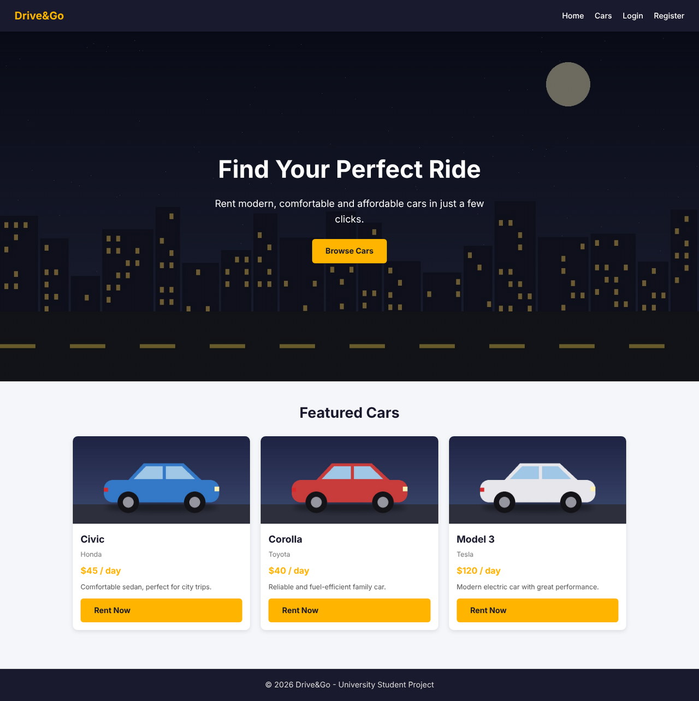
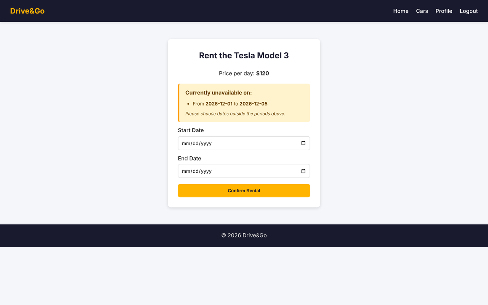
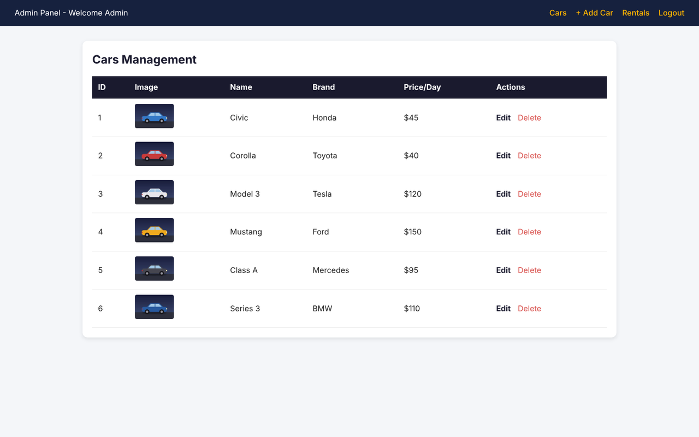

# Drive&Go — Car Rental Web App

A car rental website in plain PHP + MySQL: customers browse cars, check availability and book
rentals; admins manage the fleet and see every booking.

Built as a university project, then **security-reviewed and hardened** (see
[SECURITY.md](SECURITY.md) for the findings and fixes).



| Booking a car (with availability check) | Admin — cars management |
|---|---|
|  |  |

More: [all cars](screenshots/cars.png) · [admin rentals list](screenshots/rentals.png)

## Features

- Register / login, with roles (`user`, `admin`)
- Browse the fleet, see each car's upcoming bookings
- Book a car for a date range — overlapping bookings are rejected, total price is computed server-side
- Profile page (update name, phone, password)
- Admin panel: add / edit / delete cars, list all rentals

## Tech

PHP 8 (PDO) · MySQL / MariaDB · HTML/CSS, no framework

## Run it locally (XAMPP)

1. Copy the folder into `htdocs/` (e.g. `C:\xampp\htdocs\car_rental`).
2. Start Apache and MySQL, open phpMyAdmin and import `database.sql`.
3. Open <http://localhost/car_rental/>.

Demo accounts: **admin / admin1234** (admin) and **demo / demo1234** (customer).

Database settings are read from environment variables, with XAMPP defaults:

| Variable | Default |
|---|---|
| `DB_DSN` | `mysql:host=localhost;dbname=car_rental;charset=utf8mb4` |
| `DB_USER` | `root` |
| `DB_PASS` | *(empty)* |

## Project structure

```
index.php, cars.php, rent.php      public pages
login.php, register.php, profile.php
admin/                             admin panel (role-protected)
*.class.php                        data access (user, car, rental)
config.php                         DB connection + escaping / CSRF helpers
database.sql                       schema + seed data
```
